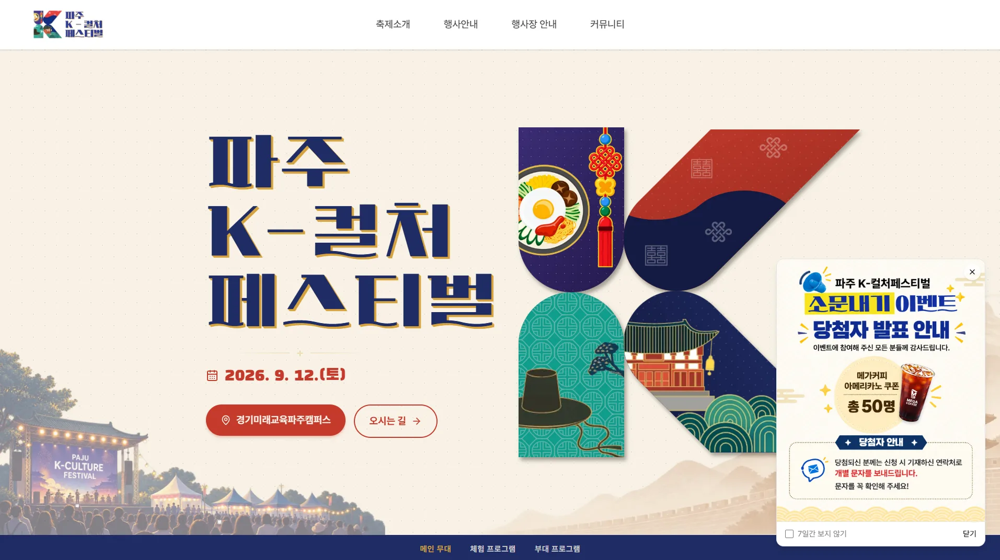
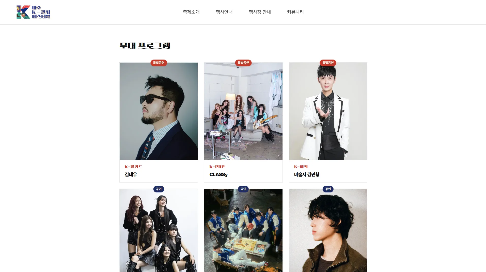
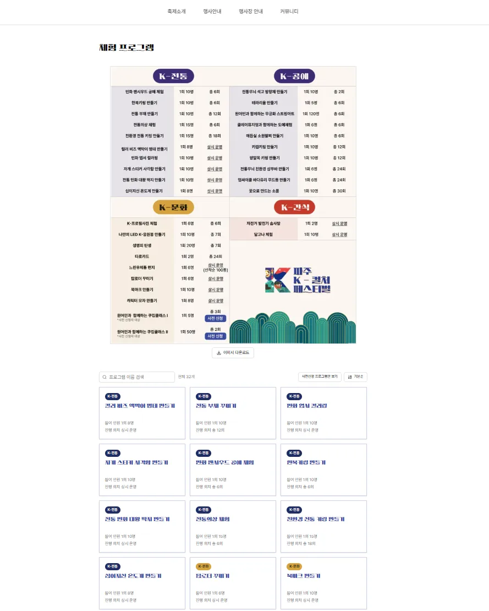
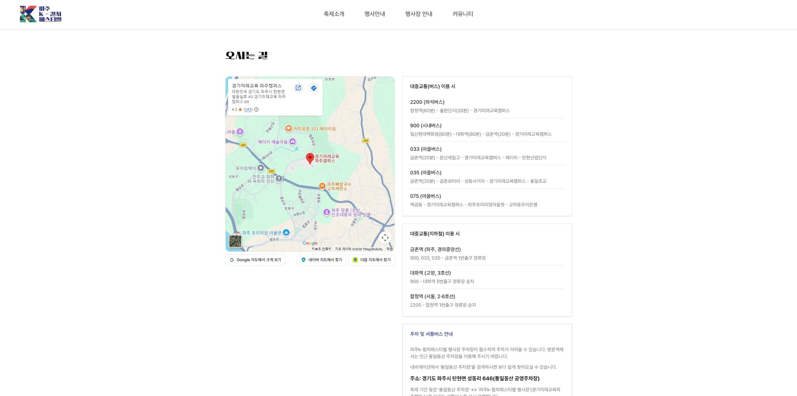
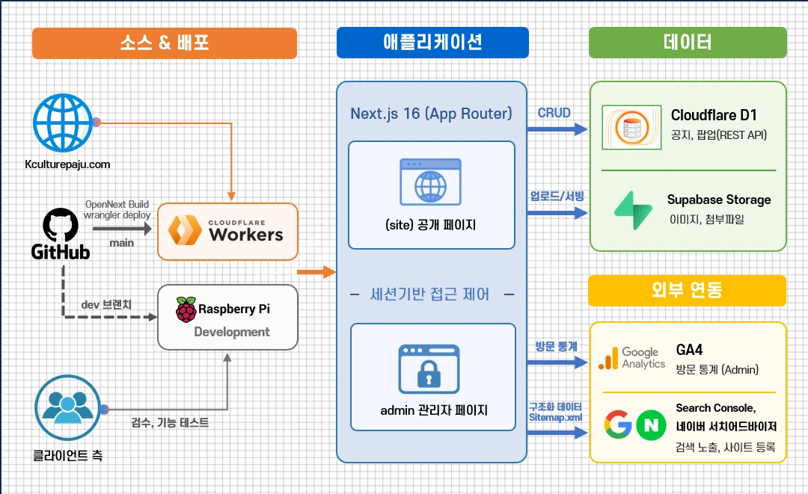

# 2026 파주 K-컬처 페스티벌 공식 홈페이지

> 축제 안내 페이지와, 기관 담당자가 공지와 팝업을 관리하는 관리자 페이지



## 1. 개요

| 항목 | 내용 |
|---|---|
| 기간 | 2026.07 ~ 08 (약 1개월), 행사 9월 12일 |
| 주최, 주관 | 경기도, 경기도평생교육진흥원 / 경기미래교육 파주캠퍼스 |
| 참여 | 개발 1명 |
| 담당 | 프론트엔드, 백엔드, 배포 |
| 기술 | Next.js 16, React 19, TypeScript, Tailwind CSS 4, TipTap, Recharts, Cloudflare Workers, D1, Supabase Storage, GA4 Data API |
| 링크 | [kculturepaju.com](https://kculturepaju.com), [상세 설명](https://subdevpi.mywire.org/portfolio/2026-파주-K-컬처-페스티벌) |

## 2. 화면

| 무대 프로그램 | 체험 프로그램 |
|---|---|
|  |  |
| 출연진 카드, 장르 라벨과 공연 구분 배지 | 32개 프로그램 이름 검색, 정렬, 사전신청 버튼 |

| 오시는 길 |
|---|
|  |
| 출발지별 버스, 지하철 경로와 지도 앱 연결, 셔틀버스 안내 |

## 3. 주요 기능

- 행사 안내: 행사 개요, 일정, 무대 프로그램, 체험 프로그램, 부대 행사, 오시는 길, 행사장 지도, 셔틀버스
- 공지사항: 관리자가 TipTap 에디터로 작성, 본문 이미지와 첨부파일 업로드, 상단 고정
- 팝업: 관리자가 게시 기간과 순서를 정해 메인에 띄우고, 방문자는 "N일간 보지 않기"로 닫음
- 관리자: 공지와 팝업 관리, GA4 방문 통계(방문자 추이, 많이 본 페이지, 유입 경로)
- 체험 프로그램 사전신청 버튼: 정해진 오픈 시각(KST)이 되면 자동으로 활성화

## 4. 구성



```
src/
├── app/
│   ├── (site)/                공개 페이지
│   ├── admin/(protected)/     관리자 페이지 (layout에서 세션 확인)
│   └── api/admin/             로그인, 공지, 팝업, 업로드 API
├── features/                  홈 섹션, 공지 팝업
├── components/                공용 UI, 관리자 컴포넌트
├── data/                      무대, 체험, 부대 행사 정적 데이터
└── lib/
    ├── auth.ts                비밀번호 해싱, 세션 서명과 검증
    ├── d1.ts                  D1 REST API 호출
    ├── sanitize.ts            공지 본문 HTML 필터
    └── ga4.ts                 GA4 통계 조회
```

운영은 Cloudflare Workers, 기관 담당자 확인용 개발 브랜치는 홈서버(라즈베리파이, `next start` + PM2)에 같은 코드로 올렸습니다.

## 5. 기술 선택

| 기술 | 고른 이유 |
|---|---|
| Cloudflare Workers | 사전신청 기간과 행사 당일 말고는 방문이 거의 없는 사이트라, 월 정액인 Vercel Pro 대신 쓴 만큼만 비용을 내는 Workers를 골랐습니다. 행사 기간 한 달만 유료 플랜으로 올리고 이후 무료 플랜으로 내렸습니다. |
| Web Crypto (PBKDF2, HMAC) | Workers와 라즈베리파이(Node.js)에서 같은 코드가 돌아야 해서, 한쪽에서만 동작하는 `bcrypt` 대신 두 곳 모두에 있는 표준 암호화 API를 썼습니다. |
| D1 REST API | Workers 전용 바인딩은 라즈베리파이에서 쓸 수 없어서 두 환경에서 똑같이 동작하는 REST API로 접근했습니다. |
| Supabase Storage | 공지 이미지와 첨부파일 보관용입니다. |

## 6. 구현하며 고려한 점

### 6-1. Workers 배포 오류

- 상황: Next.js 16의 `proxy.ts`(구 `middleware.ts`)는 항상 Node.js 런타임으로 도는데, 당시 Cloudflare 어댑터(`@opennextjs/cloudflare` 1.20.2)가 이를 지원하지 않아 보호된 경로마다 오류가 났습니다.
- 처리: `proxy.ts`를 없애고 관리자 레이아웃과 API에서 세션을 직접 확인하게 바꿨습니다. 비밀번호 해싱(PBKDF2)은 로그인할 때 한 번만 하고, 요청마다 하는 세션 확인은 HMAC 서명 검증으로 처리했습니다.
- 단점: 새 관리자 페이지나 API를 만들 때 세션 확인을 빠뜨리지 않도록 신경 써야 합니다.

자세한 과정은 블로그에 정리했습니다. [Cloudflare Workers, K-컬처 페스티벌 배포기](https://subdevpi.mywire.org/posts/DevOps/Cloudflare-Workers-%E2%80%94-K-%EC%BB%AC%EC%B2%98-%ED%8E%98%EC%8A%A4%ED%8B%B0%EB%B2%8C-%EB%B0%B0%ED%8F%AC%EA%B8%B0)

### 6-2. 공지 본문과 업로드 파일

공지는 관리자가 쓴 HTML을 방문자 화면에 그대로 그립니다. 다른 곳에서 복사한 내용에 스크립트가 섞이면 모든 방문자의 브라우저에서 실행될 수 있어서 아래처럼 막았습니다.

- 저장할 때 허용한 태그, 속성, 인라인 스타일만 남기고 지웁니다. 링크는 `http`, `https`, `mailto`만 허용하고, 새 창 링크에는 `rel="noopener noreferrer"`를 붙입니다.
- 본문 이미지, 팝업 이미지, 첨부파일 주소는 자체 Storage 경로만 받습니다.
- 업로드 이미지는 브라우저가 보낸 형식 정보 대신 파일 앞부분을 읽어 실제 형식을 확인합니다.

### 6-3. 관리자 로그인

- 같은 IP에서 15분 안에 10번 실패하면 15분 동안 로그인을 막습니다.
- 없는 아이디로 로그인해도 같은 시간만큼 해싱해서, 응답 시간으로 계정이 있는지 알 수 없게 했습니다.
- 세션 쿠키는 `httpOnly`, `SameSite=Lax`로 설정했습니다.

### 6-4. 검색 노출과 이미지 경량화

- 11개 페이지에 제목, 설명, 대표 주소(canonical), 공유 미리보기(Open Graph)를 빠짐없이 넣기 위해 공통 값은 상수로 모으고, 페이지에서는 제목, 설명, 경로만 넘기는 함수(`createPageMetadata`)를 만들었습니다.
- 메인에는 행사 날짜와 장소가 검색 결과에 보이도록 JSON-LD를 넣었고, sitemap은 요청 시점에 공지 목록까지 읽어 만듭니다.
- 메인 배경과 패턴 이미지를 압축해 11.9MB에서 1.7MB로 줄였습니다.

## 7. 결과

- 2026.08 배포 후 행사(9월 12일)까지 운영했습니다.
- 메인 이미지 용량 11.9MB에서 1.7MB로 감소
- Search Console 구조화 데이터 검사에서 필수 항목 오류 0건

## 8. 실행 방법

```bash
npm install
npm run dev
```

`.env.local`에 아래 값이 필요합니다. (커밋하지 않음)

| 이름 | 용도 |
|---|---|
| `CLOUDFLARE_ACCOUNT_ID`, `CLOUDFLARE_D1_DATABASE_ID`, `CLOUDFLARE_API_TOKEN` | D1 REST API 접속 |
| `ADMIN_SESSION_SECRET` | 관리자 세션 서명 키 |
| `SUPABASE_URL`, `SUPABASE_SERVICE_ROLE_KEY` | 공지 이미지, 첨부파일 저장 |
| `GA4_PROPERTY_ID`, `GA4_SERVICE_ACCOUNT_EMAIL`, `GA4_SERVICE_ACCOUNT_PRIVATE_KEY` | 관리자 방문 통계 |
| `NEXT_PUBLIC_GA_MEASUREMENT_ID` | 방문 추적 |

D1 스키마(`admins`, `notices`, `notice_attachments`, `notice_popups`)는 저장소에 포함하지 않았습니다. 관리자 계정은 `hashPassword()`로 만든 해시를 `admins` 테이블에 직접 넣습니다.

Workers 배포는 `npm run cf:deploy`로 하고, 비밀 값은 `wrangler secret put`으로 넣습니다.

## 9. 회고

Vercel에서는 신경 쓰지 않던 런타임 차이를 처음으로 직접 겪은 프로젝트였습니다. 대안을 고를 때마다 "두 배포 환경에서 모두 도는가"를 기준으로 삼았고, 그 덕분에 운영 서버와 확인용 서버에 같은 코드를 그대로 올릴 수 있었습니다.
